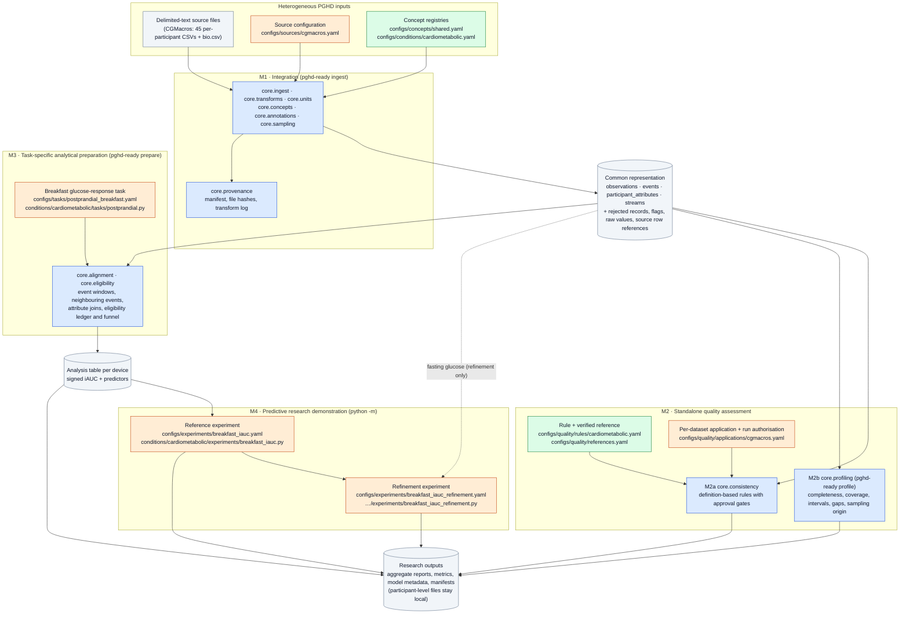
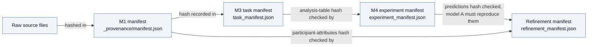

# PGHD-Ready architecture

This page shows how the toolkit is actually built today. The [implemented-vs-planned table](#what-is-and-is-not-implemented) at the end says what the diagrams do *not* show. For the worked example, see [the demo README](README.md).

## End-to-end workflow

Colours mark the three layers:
- **blue:** reusable toolkit code and shared configuration;
- **green:** cardiometabolic rules and concepts;
- **orange:** configuration and code specific to CGMacros or to the breakfast task;
- **grey:** files and outputs.

Reading the diagram:
- **Integration is configuration-first.** CGMacros is ingested through YAML alone, with no CGMacros-specific Python code. The engine's built-in declarative transforms cover column mapping, units, documented limits and error codes. A transform registry exists for sources that need custom code.
- **Quality assessment is standalone.** M2 needs no task, model or labels, and it does not change the data.
- **Research logic sits at the edges.**
  - The M3 core modules know nothing about glucose or meals; the breakfast-specific definitions are in the task config and module.
  - The M4 experiments are single-purpose modules, not a model framework.
  - A test (`tests/test_core_independence.py`) fails if dataset or condition terms appear in `core/`.

## Layers in the package

```mermaid
flowchart LR
    classDef core fill:#dbeafe,stroke:#1d4ed8,color:#0f172a
    classDef cond fill:#dcfce7,stroke:#15803d,color:#0f172a
    classDef study fill:#ffedd5,stroke:#c2410c,color:#0f172a

    subgraph G["Reusable toolkit · src/pghd_ready/core + cli.py"]
        direction TB
        g1["ingest, config, transforms, units, concepts"]:::core
        g2["schemas, annotations, sampling, provenance, io, report"]:::core
        g3["consistency (M2a), profiling (M2b)"]:::core
        g4["alignment, eligibility (M3)"]:::core
    end
    subgraph C["Cardiometabolic · src/pghd_ready/conditions/cardiometabolic + configs"]
        direction TB
        c1["meal event schema"]:::cond
        c2["cardiometabolic concepts and units"]:::cond
        c3["non-HDL derivation rule (NCEP ATP III)"]:::cond
    end
    subgraph S["CGMacros study and breakfast task"]
        direction TB
        s1["CGMacros source mapping and quality application"]:::study
        s2["postprandial breakfast task (M3)"]:::study
        s3["breakfast iAUC experiments (M4)"]:::study
    end
    S --> C --> G
    S --> G
```

Arrows point from what *uses* to what is *used*. Study and condition code depends on the core, and the core depends on neither.

## Provenance and lineage

Each stage writes a manifest recording the SHA-256 hashes of its inputs and outputs, its configuration hash and the code commit. M3 records the hashes of the M1 files it read. The M4 experiments go further and refuse to run if their inputs do not match the hashes recorded by the earlier stage.

The M2b profile has its own manifest (`profile_manifest.json`) that hashes the M1 outputs it read. M2a writes no files; it runs in memory and is gated by content hashes of the approved rule and of the dataset application.

## What is and is not implemented

| Area | Implemented | Not implemented (yet) |
|---|---|---|
| Inputs | Delimited text (CSV) via YAML configuration; a transform registry for custom code | JSON, FHIR, Open mHealth, free text |
| Representation | Observations, events, participant attributes and streams; three-state sampling origin; flags and annotations | Medication and patient-reported representations |
| M2a | One rule type (linear derivation); one rule (non-HDL); review-mode run | File writers, a CLI, plausibility rules |
| M2b | Descriptive profiling per participant, stream and day | Libre–Dexcom agreement, event and attribute profiling, figures |
| M3 | Generic windows and eligibility; one task (breakfast iAUC) | Lunch and dinner, use of the quality profile in eligibility |
| M4 | Two bounded experiments on one dataset | A general modelling framework, external validation |
| Sources tested | CGMacros; one fictional synthetic dataset | A second real dataset |
